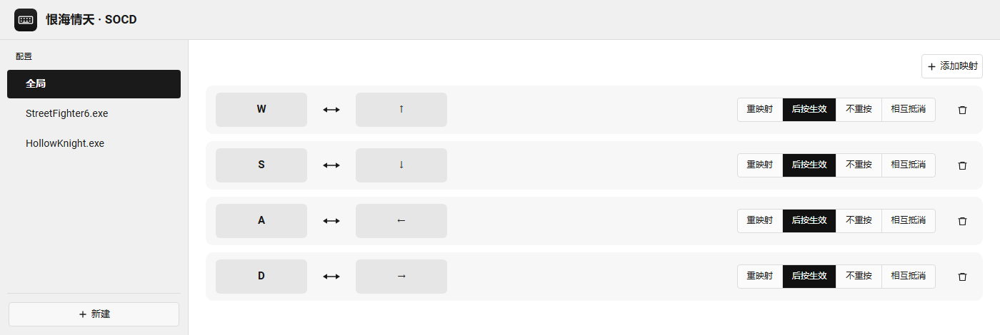
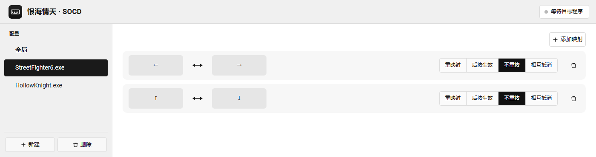

# 恨海情天 · SOCD

Windows 下的按键重映射工具，专为格斗游戏与横版平台的方向键冲突处理设计。

单个 exe，无安装、无依赖。界面在本机浏览器里打开。



> 本项目是 [valignatev/hitboxer](https://github.com/valignatev/hitboxer)（Jai 编写）的 Rust 重写版。
> 配置文件格式与 SOCD 行为与原版保持一致，旧的 `settings.socd` 可以直接使用。

**SOCD** 是 Simultaneous Opposite Cardinal Direction 的缩写：同时按下相反方向键。格斗游戏里"蹲防切前进会不会丢输入"这类问题都出在这里。

## 它解决什么问题

同时按住左和右会发生什么，各游戏处理不一：有的两个都生效（角色抖回原地），有的抵消（什么都不动），有的取后按的那个。硬件层面上 Windows 只是把两个按键事件原样转发，规则由接收方决定——而你往往没法改游戏。

这个程序在按键到达游戏之前介入，把两个方向合成一个你指定的结果。比如保证"后按方向优先"：从蹲防切前进时，按下前进立刻生效，松开前进又自动回到蹲防，中间不丢帧。

支持四种模式：

| 模式 | 行为 |
|---|---|
| 重映射 `REMAP` | 按下左键时改为输出右键，原按键被吞掉 |
| 对向·后按生效 `OPPOSITE` | 两个相反方向同时按住时后按的生效；松开后自动回到先按的方向 |
| 对向·不重按 `OPPOSITE_NO_REPRESS` | 同上，但松开后不回到先按的方向 |
| 对向·相互抵消 `NEUTRAL` | 两个相反方向同时按住时互相抵消，两个都不输出 |

新建映射默认使用「对向·后按生效」，这是最常见的需求。

映射按程序生效：每个配置绑定一个前台进程名，只有它位于前台时才工作；`program` 留空的"全局"配置对所有程序生效。

## 和磁轴键盘的 SOCD 有什么区别

近几年的磁轴键盘（Wooting、Razer Huntsman V3 Pro 系列，以及大量国产磁轴方案）很多都在固件里做了 SOCD 处理，能在厂商的配置软件或键盘组合键里切换处理方式。既然键盘自己就能做，为什么还需要这个程序？

**因为两者做的事不在同一层。**

| | 键盘固件 SOCD | 本程序 |
|---|---|---|
| 作用位置 | 键盘硬件输出之前 | Windows 收到按键之后 |
| 生效范围 | 整块键盘，所有程序一视同仁 | 按前台程序切换，可以只对某个游戏生效 |
| 可配置的键 | 取决于固件，多数是固定的方向键对 | 任意两个键之间，包括不对称映射 |
| 切换方式 | 厂商软件或键盘组合键 | 点界面上的标签页，切到别的程序时自动让路 |
| 需要的硬件 | 必须是支持该功能的键盘 | 任何标准键盘 |

具体支持哪些模式、能改哪些键，各家固件差别很大，以键盘自己的说明为准。

几个实际差别：

**键盘固件不知道"现在在哪个程序里"。** 它没有这个概念，SOCD 是个全局开关。你在格斗游戏里想要的"后按优先"，到了编辑器里就变成干扰——按住左再按右，光标跳回左边，松开右又跳回右边。本程序只在指定进程位于前台时才接管，切出去就完全放行。

**能改的键通常更少。** 固件里的 SOCD 往往只针对方向键那几对；如果用的是 `J`/`L` 这类自定义街机布局，或者想顺带把 `CapsLock` 改成 `Ctrl`，就得靠软件层。本程序可以映射任意扫描码。

**反过来也有它的优势，值得说清楚：** 键盘层的处理发生在硬件输出之前，游戏看到的就是"只按了一个方向"，从输入栈最底层就干净；而且不依赖任何软件常驻，不吃 CPU、不会被杀软误报、也不会因为全局键盘钩子被反作弊拦下。如果你只用一块键盘、只玩一个游戏、厂商给的模式正好合口味，用键盘自己的 SOCD 就够了。

**两者可以叠加，但效果是串行的。** 键盘先把左右合成为一个方向发给系统，程序再对合成后的结果判断——如果键盘已经消掉了冲突，程序这一层就没什么可做的了。想让程序完全接管，就去厂商软件里把键盘的 SOCD 关掉，让两个键原样上报。

## 安装与使用

1. 从 [Releases](../../releases) 下载 `SOCD.exe`
2. 放到一个可写目录（**不要放 `Program Files`**，程序需要在旁边生成配置）
3. 双击运行，浏览器会自动打开配置界面
4. 托盘图标常驻；关掉标签页不影响映射，左键点托盘图标可重新打开

程序只监听 `127.0.0.1`，端口由系统随机分配，每次启动生成一次性令牌注入页面。别的网页即使猜到端口也拿不到令牌，无法驱动你的键盘映射。

## 配置

界面点「新建」选择程序，再为它添加映射。点键位框，然后按下想绑定的键。

左侧每个标签是一个配置。标为「全局」的那个对所有程序生效；以程序名命名的只在它位于前台时接管，右上角的状态会显示当前是否已对上目标窗口。



配置文件在 exe 旁自动生成：

```
Data/settings.socd
```

```text
[1] # Config version, do not delete this!!!

PROFILE_START
active: true
program: 
mapping: OPPOSITE 17 57672
mapping: OPPOSITE 31 57680
PROFILE_END
PROFILE_START
program: StreetFighter6.exe
mapping: OPPOSITE_NO_REPRESS 57675 57677
PROFILE_END
```

- `program` 为空表示全局配置，对所有程序生效
- `mapping: <模式> <源扫描码> <目标扫描码>`，每行一条
- `active: true` 标记界面上当前选中的配置
- 扫描码超过 0xFFFF 的是扩展键（方向键、小键盘等），带 `0xE100` 标记，与原版一致

不需要手动编辑这个文件，界面会管好它。需要跨机器同步配置时直接复制即可。

## 构建

需要 Rust 与 Python 3（生成与嵌入图标用）。

```bash
./build.sh
```

产物是 `release/SOCD.exe`，单个文件，没有任何附带 DLL。

默认使用 GNU 工具链，可通过环境变量覆盖：

```bash
SOCD_TOOLCHAIN=+stable-x86_64-pc-windows-msvc ./build.sh
```

GNU 工具链需要 `cargo`、`rustc` 与 MinGW 的 `dlltool` 在 `PATH` 中。没有 `dlltool` 时，Windows 导入库会链接失败。

## 测试

```bash
# 单元测试：配置读写 + SOCD 状态机 + 键名
cargo test

# 端到端：先启动一个固定端口的实例
SOCD_INSTANCE_SLOT=t ./release/SOCD.exe --no-open --port=17654

python tests/e2e_func.py 17654     # 21 项：经真实命令通道驱动状态机
python tests/e2e_real.py 17654     # 5 项：真实 Win32 钩子回调 + 按键注入
python tests/probe_server.py 17654 # 可选：HTTP 服务的健壮性检查
```

`SOCD_INSTANCE_SLOT` 给单实例锁加后缀，让测试实例与你正在用的实例互不干扰。

`e2e_real.py` 依赖真实的合成按键，**锁屏时会失败**（此时 `SendInput` 不生效）——这是 Windows 的限制，不是代码问题。

## 实现要点

```
src/
  main.rs            托盘、消息循环、进程生命周期
  server.rs          内置 HTTP 服务：托管界面 + 命令接口
  app.rs             控制器：配置、命令分发、profile 热切换
  socd.rs            SOCD 状态机（纯逻辑，无 Win32，可单测）
  settings.rs        settings.socd 解析与序列化
  paths.rs           数据目录（exe 旁的 Data/，不可写时退回用户目录）
  single_instance.rs 命名互斥量 + 共享内存传递界面地址
  win.rs             Win32：键盘钩子、扫描码注入、前台进程检测、键名
ui/
  index.html         整个前端（单文件，无构建步骤，无外部依赖）
assets/
  icon.ico           多尺寸图标，由 make_icon.py 生成并嵌入 exe
  icon-256.png       同一图标的 PNG，编译时嵌入二进制供托盘使用
```

几个不那么显然的约束，改代码前值得知道：

- **主线程必须跑消息循环。** `WH_KEYBOARD_LL` 的回调通过安装钩子的那个线程的消息队列投递。不抽消息，钩子一次都不会被调用，键盘映射等于失效。
- **注入事件必须被过滤。** 钩子注入的按键同样会经过钩子链，不做 `LLKHF_INJECTED` 过滤就会自己处理自己的注入，形成递归。
- **扩展键要带 `0xE100` 标记。** 方向键、小键盘的扫描码与主键盘区冲突，原版用这个标记区分，这里保持一致。
- **单实例是必须的。** 两个进程各装一条钩子会处理同一次按键两遍，表现为重复或丢失。
- **界面地址走共享内存而非文件。** 第二个实例读取第一个实例公布的地址；用命名共享内存，进程退出即消失，不会在配置目录留下需要清理的残留。

## 已知限制

- **只在 Windows 上实现。** Linux 需要 libinput + uinput，是另一套平台层；`socd.rs` 与 `settings.rs` 可以直接复用。
- **反作弊可能拦截。** `WH_KEYBOARD_LL` + `SendInput` 这套方案本身就会被 Vanguard 之类的驱动盯上，换语言不改变这一点。
- **可能被杀软误报。** 全局键盘钩子 + 模拟输入的行为特征就是这样，与原版相同。
- **管理员权限的程序检测不到。** 前台检测走 `OpenProcess`，遇到提权进程会拒绝访问，这是 issue 里"映射不到游戏"的常见原因之一。
- **中文键名用固定对照表。** 覆盖常见功能键，外设自定义键仍显示 Windows 给的英文原名。
- **不如键盘固件"底层"。** 软件层要等 Windows 收到按键后再处理，理论上比键盘固件多一层延迟。实际使用中察觉不到，但如果你的键盘自带能用的 SOCD，那仍然是更干净的选择——见上文对比。

## 许可

MIT。原项目 [valignatev/hitboxer](https://github.com/valignatev/hitboxer) 同样以 MIT 发布，见 [LICENSE](LICENSE)。
